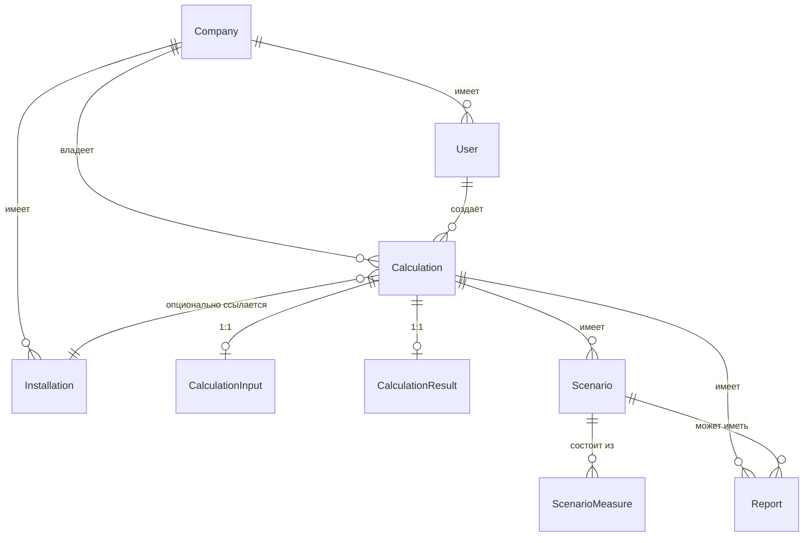

# Модель данных

Реализация: `apps/api/app/models.py` (SQLAlchemy 2.0, async), миграция —
`alembic/versions/d5c26a1dba5e_initial_schema.py`.

## Сущности

| Сущность | Назначение | Примечание |
|---|---|---|
| `Company` | компания-экспортёр | `inn`, `industry`, `size`, `region_id` |
| `User` | пользователь ЛК | `role` (`company_user`/`admin`), привязан к одной `Company` |
| `Installation` | производственная площадка | опционально привязана к расчёту |
| `Calculation` | версия расчёта | `status` (`draft`/`final`), `version`, `supersedes_id` (связь версий), `factor_version` |
| `CalculationInput` | черновик ввода | JSONB, валидируется `ecobalance_core.models.CalculationInput` на каждый `PATCH` и перед `calculate` |
| `CalculationResult` | результат расчёта | JSONB, сериализованный `ecobalance_core.models.CalculationResult` |
| `Scenario` + `ScenarioMeasure` | сценарий оптимизации | `Scenario.result_data` кэширует `{baseline, scenario, delta_*}`; `ScenarioMeasure` хранит выбранные меры и допущения по каждой |
| `Report` | запись о сформированном отчёте | `report_type`, `report_format`, `file_path` (файл на диске, не в БД) |
| `EmissionFactor` | снимок справочных коэффициентов | заполняется `scripts/seed.py` из `ecobalance_core.reference`, `is_demo` |
| `ReferenceItem` | снимок продуктов/маршрутов | та же роль, для не-численных справочников |
| `AuditLog` | журнал действий | определена в схеме; запись в неё при финализации расчёта и выгрузке отчётов — **не подключена в этой версии** (см. открытые вопросы) |

## Неизменяемость финального расчёта

`Calculation.status = "final"` блокирует `PATCH /calculations/{id}`
(`409 Conflict`) и повторный `finalize` (`409 Conflict`). Правка после
финализации в этой версии не создаёт новую версию автоматически —
пользователь создаёт новый `Calculation` вручную. Полная цепочка версий
через `supersedes_id` (поле в схеме есть) UI не использует — колонка
подготовлена для будущей работы, но автоматическое versioning на
`PATCH` финального расчёта не реализовано.
