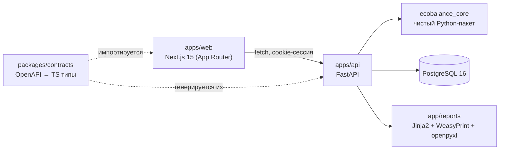
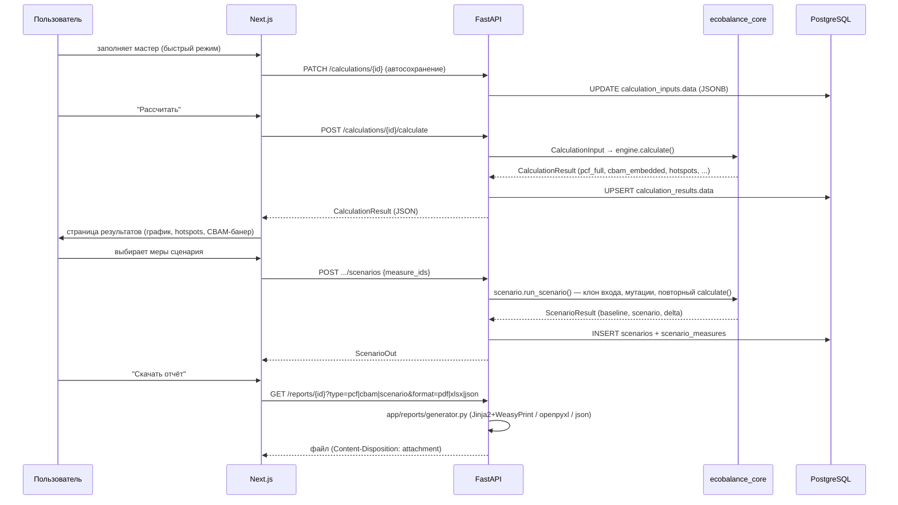

# Архитектура: обзор

## Компоненты



`ecobalance_core` не зависит от FastAPI/БД — это чистая методология
(units → models → scope1/2/3 → allocation → engine → hotspots →
measures/scenario). `app/` — тонкий слой вокруг него: модели БД, auth,
CRUD, генерация отчётов из уже посчитанного `CalculationResult`.

## Поток данных: от ввода к отчёту



## Монорепозиторий

```
apps/
  web/            # Next.js 15, React 19, TypeScript strict, Tailwind
  api/
    ecobalance_core/   # методология (Stage 1)
    app/               # FastAPI: routers, models, security, reports (Stage 2)
    alembic/           # миграции
    config/            # hotspots.yml, measures.yml
    scripts/           # seed.py, export_openapi.py
    tests/
packages/
  contracts/      # openapi.json + сгенерированные TS-типы (Stage 2)
docs/             # mkdocs (этот сайт)
```

## Границы изоляции между компаниями

Каждый запрос к `Calculation`/`Scenario`/`Report`/`Installation`
проходит через `company_id == current_user.company_id` на уровне
запроса (не на уровне ORM-политики БД) — см.
`app/routers/calculations.py::_get_own_calculation` и аналоги в других
роутерах. Проверено интеграционным тестом
(`test_company_isolation`): компания A получает `404`, а не `403`, при
попытке прочитать расчёт компании B — это не раскрывает даже факт
существования чужого ресурса.
